<!--
  SEO: Earth Jukebox — Change Mode (Aham-Bhramasmi) is a NASA Space Apps Challenge 2026 submission
  that turns NASA Earth-at-Night imagery (2012 vs 2023) into music. A computer-vision pass aligns
  and normalises the frames, diffs them on a 16×16 grid and ranks the 32 changed cells; the Web Audio
  engine then plays them as a deterministic stereo piece — bigger change = higher pitch, column =
  stereo position, biggest change first. Keyboard-first, screen-reader ready, WCAG 2.2 AA design
  target, WAV export, bring-your-own JSON. Live demo: aham-bhramasmi.vercel.app
  Team: Diksha Mukherjee Agarwal, MD Mamun, Sofiur Rahaman, Anumitra Saha, Drishan Roy.
-->

<div align="center">

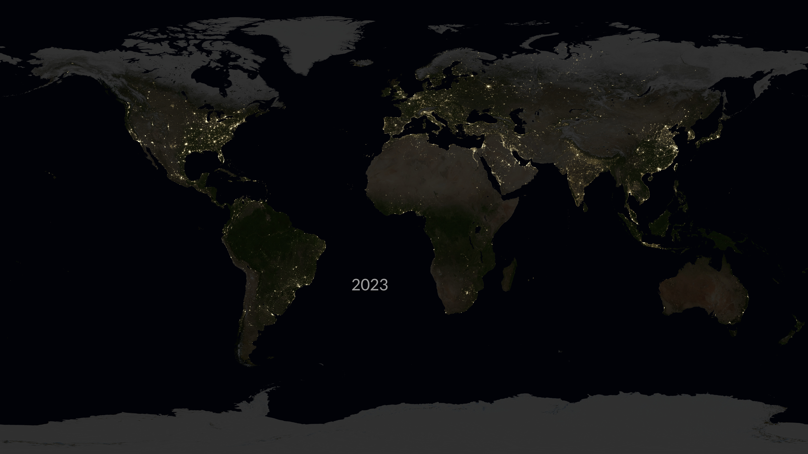

# 🌍 Earth Jukebox

### *Change Mode*

**Hear how the Earth changes, one note at a time.**

**Two NASA night-lights frames. 256 grid cells. 32 notes. One short piece of music — and a way to explore a map you cannot see.**

<sub>Aham-Bhramasmi · NASA Space Apps Challenge 2026 · *The Earth Information Jukebox*</sub>

<br>

[](https://aham-bhramasmi.vercel.app/)
[](https://forms.gle/GLLUH9Xqfxu6byCq6)


[](https://github.com/Diksha-MukherjeeAgarwal/Aham-Bhramasmi/stargazers)
[](https://github.com/Diksha-MukherjeeAgarwal/Aham-Bhramasmi/network/members)
[](https://github.com/Diksha-MukherjeeAgarwal/Aham-Bhramasmi/commits)

<br>

**[▶ Open the live demo](https://aham-bhramasmi.vercel.app/)** · **[🎼 The mapping](#-the-mapping-data--sound)** · **[⌨️ Keyboard](#%EF%B8%8F-keyboard-first)** · **[♿ Accessibility](#-accessibility-is-the-feature-not-the-appendix)** · **[👥 Team](#-team)**

</div>

---

## 📖 The problem

Two barriers stand between people and this data.

**1 · It is visual only.** Earth observation arrives as maps, charts and satellite imagery. For people who are blind or have low vision, the answer is locked behind a picture.

**2 · The obvious fix is unusable.** Pixel-to-sound sonification converts *too much* information into sound at once — a wall of noise where nothing stands out and nothing can be compared.

**Earth Jukebox addresses both:** run computer vision first to find the cells that actually changed, rank them by magnitude, and sonify only those — as a short, learnable, deterministic musical statement rather than a raw audio dump.

> A geospatial map answers *"where?"* for people who can see it.
> Night-lights data answers *"where did the lights change?"* — one of the most human questions in remote sensing: growth, outages, migration, war, gas flares.
> We make that answer **audible, comparable and inspectable**.

---

## ⚡ At a glance

| | |
|---|---|
| 🛰️ **Source** | NASA Earth Information Center / Scientific Visualization Studio |
| 🗺️ **Grid** | 16 × 16 = **256 cells** |
| 🎵 **Playable** | **32 notes** — 30 increases, 2 decreases |
| 🔇 **Silent** | 224 stable cells, deliberately skipped |
| 🎼 **Scale** | D minor pentatonic, 11 steps, **D4 → D6** |
| ⏱️ **Piece** | One note every 0.8 s, capped at 30 s — the sample file fits completely (~26 s) |
| 🎧 **Voices** | Triangle (▲ bright, short) · Sine (▼ dark, slow, one octave down) |
| 🧭 **Stereo** | Column → left/right, **90 %** of the field |
| 🖥️ **Site** | 5 routes, React 18 + Vite 5 + three.js, hash routing |
| ♿ **Access** | Keyboard-first, screen-reader summaries, accessibility mode, WCAG 2.2 AA target |
| 📦 **Offline** | System fonts, no CDN, no runtime calls except local files |

---

## 🚀 How it works — four stages

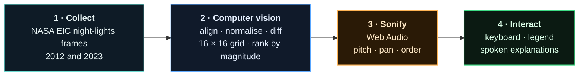

**1 · Data collection.** NASA's Earth Information Center visualization *Change in Night Lights between 2012 and 2023* puts two global night-lights frames side by side, so changes in artificial light become visible.

**2 · Computer vision.** The frames are aligned and normalised, the differences are detected, the map is divided into a **16 × 16 grid**, and every cell is ranked by the magnitude of its change. This is what makes the piece listenable: 32 cells out of 256 carry the story.

**3 · Data sonification.** The ranked changes become notes through the Web Audio API — pitch for magnitude, waveform for direction, stereo position for longitude, order for rank.

**4 · Accessible interaction.** Everything is reachable from the keyboard, a legend teaches the mapping in under a minute, and every region can be heard alone or spoken aloud.

<details>
<summary><b>What the CV pass leaves behind</b></summary>

<br>

`data/processed/earth_jukebox_results` — 256 regions, each with `row`, `col`, a relative `score`, a `signed_change` and a `direction`. 224 cells are labelled `stable` and stay silent. The player treats these numbers as **relative values**, never as raw radiance, and never invents one.

</details>

---

## 🧠 The whole system in one diagram

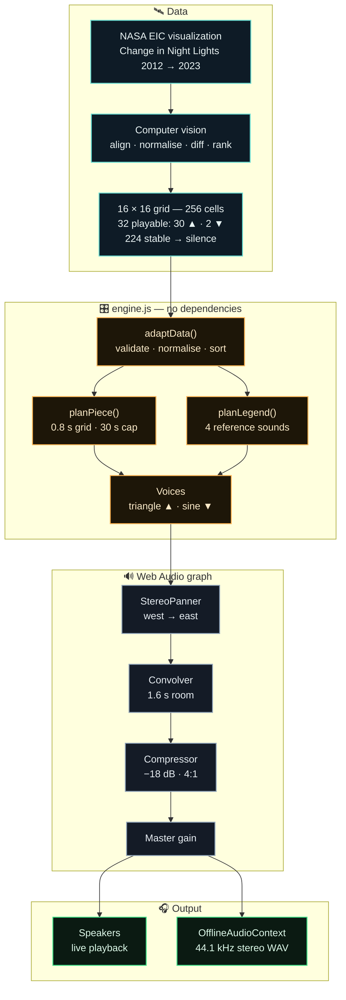

---

## 🎼 The mapping: data → sound

Six design decisions. Every one of them is fixed, printed on the site, and the same for every data file you load.

| Data | Sound | Detail |
|---|---|---|
| **Size of the change** | **Pitch** | Absolute value ÷ largest playable change → an 11-step D minor pentatonic scale, **D4–D6** |
| **An increase** ▲ | Bright, short note | Triangle wave · 10 ms attack · **0.8 s** · amber in the UI |
| **A decrease** ▼ | Dark, slow note | Sine wave · 120 ms attack · **1.2 s** · shifted **one octave down** · cyan in the UI |
| **Column** | Stereo position | West → east becomes left → right, using **90 %** of the stereo field |
| **Rank** | Order in time | Largest change first, one note every **0.8 s**, piece capped at **30 s** |
| **A stable region** | Silence | `direction: "stable"`, or no usable `signed_change` → not played |
| **Row** | *visual only* | Locates the cell in the grid and the 3D view; it is **not** sonified |

**The musical output is deterministic: the same input data produces the same composition, every single time.**

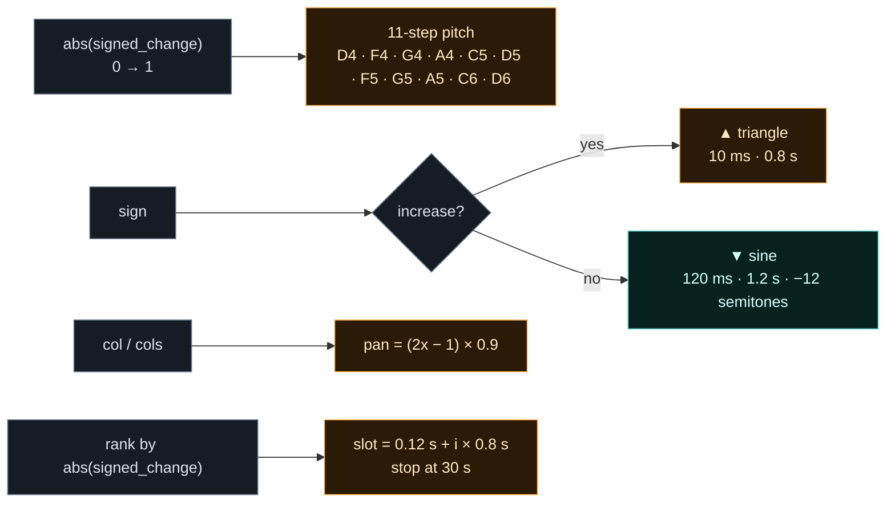

<details>
<summary><b>Reference sounds — the legend (<kbd>L</kbd>)</b></summary>

<br>

| # | Sound | Means |
|---|---|---|
| 1 | Steady sine tone on **D4**, flat top | *No change* — the baseline |
| 2 | Short bright note, ~20 % up the scale | *Small* increase |
| 3 | Short bright note, top of the scale | *Large* increase |
| 4 | Slow dark note, one octave down | *Large* decrease |

The legend is itself a deterministic plan (`planLegend()`), so it can never drift away from the live mapping.

</details>

---

## 🎧 A first listen, in 15 seconds

```text
1.  Press  Space ............ play the whole piece, largest change first
2.  Press  ←  →  ............ step through the 32 changed cells, one at a time
3.  Press  L  ............... hear the legend: no change, small, large, decrease
4.  Press  E  ............... speak the mapping out loud
5.  Press  A  ............... accessibility mode on/off
6.  Press  S  ............... stop audio and speech
7.  Press  ?  ............... every shortcut, in a modal dialog
```

Nothing plays until **you** ask for it. No autoplay, no audio on load, no surprise sound.

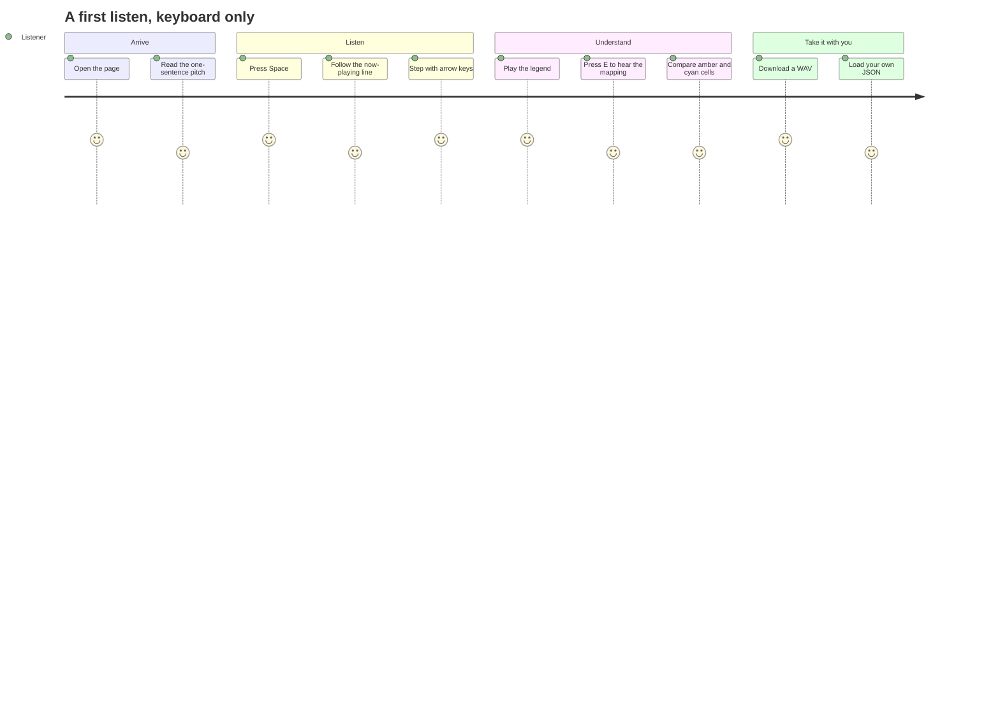

---

## 🗺️ Five routes, one idea

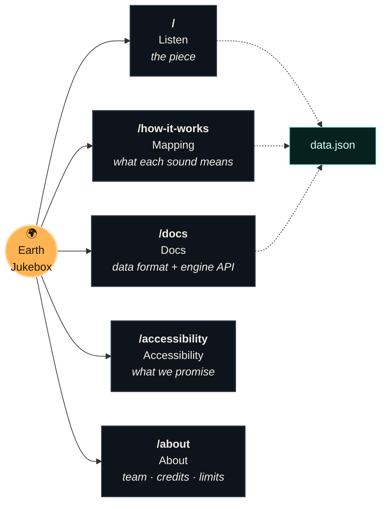

Routing uses **HashRouter**, so the static build works on any host with no rewrite rule: `#/how-it-works`, `#/docs`, `#/accessibility`, `#/about`. Each route sets the document title, moves focus to its `<h1>`, and announces the page name once in a polite live region.

---

## 🔄 What happens when you press Space

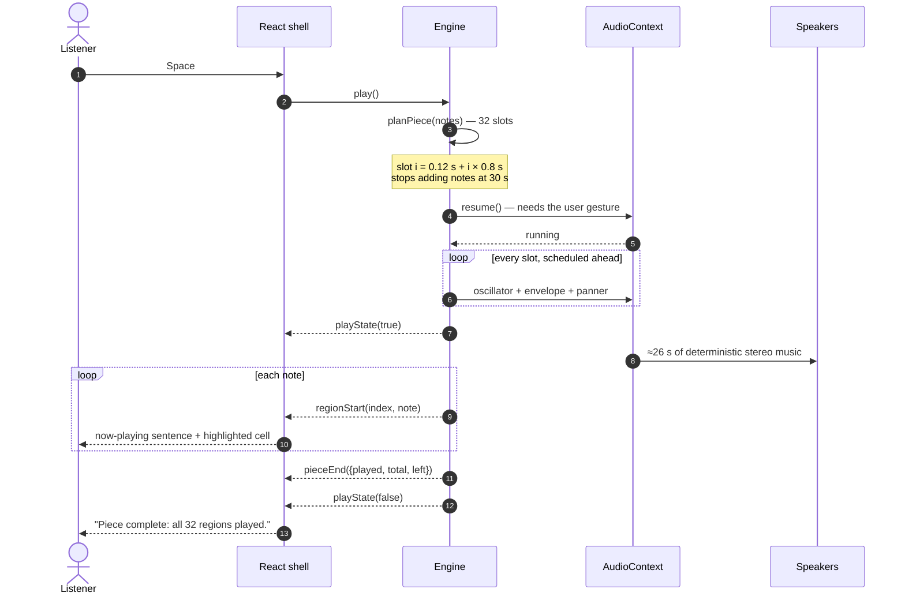

Sound is scheduled **ahead of time on the audio clock**, never with `setTimeout` alone. UI updates ride a ticket counter, so pressing <kbd>S</kbd> cancels every pending note instead of letting a stale timer talk over you.

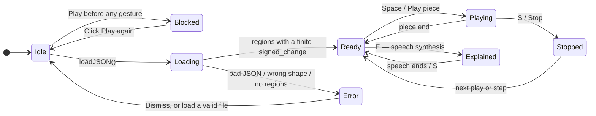

---

## ⌨️ Keyboard first

| Key | Action |
|:---:|---|
| <kbd>Tab</kbd> / <kbd>Shift</kbd>+<kbd>Tab</kbd> | Move through links, buttons and the volume slider |
| <kbd>Enter</kbd> | Activate a link or button |
| <kbd>Space</kbd> | Play the piece — **on a focused button, Space presses that button instead** |
| <kbd>←</kbd> / <kbd>→</kbd> | Previous / next region (wraps around) |
| <kbd>L</kbd> | Play the sound legend |
| <kbd>E</kbd> | Speak the explanation (browser speech synthesis) |
| <kbd>S</kbd> | Stop audio **and** speech |
| <kbd>A</kbd> | Toggle accessibility mode |
| <kbd>?</kbd> | Open the shortcuts dialog |
| <kbd>Esc</kbd> | Close the shortcuts dialog |

Shortcuts work from any page and are ignored while you type in a field or drag the slider. The dialog is a native `<dialog>` modal that keeps focus inside it until you close it.

---

## ♿ Accessibility is the feature, not the appendix

The whole point is an answer without an image. So the accessible path is the **primary** path, not a fallback.

<table>
<tr>
<td width="50%" valign="top">

**Built in, always on**

- Skip link is the first focusable item
- Full-sentence accessible names on every region: *region number, row, column, increase/decrease, size, pitch, stereo position*
- Every control is a real `<button>`, not a clickable `<div>`
- Colour is never the only cue — ▲/▼ and words carry the meaning too
- Live region announces what started, what finished, what stopped
- Per-note updates stay **out** of the live region on purpose, so speech never fights the music
- Volume slider with a spoken value (`aria-valuetext`)
- Reflows to one column at 320 CSS px; wide tables scroll in their own wrapper
- `prefers-reduced-motion`, `prefers-contrast`, `forced-colors` and `inverted-colors` all respected

</td>
<td width="50%" valign="top">

**Accessibility mode** (<kbd>A</kbd>)

- Black background, white text, **one** yellow accent
- Larger text
- No animation or transitions
- 3D view off by default (image frames take over)
- Buttons ≥ 56 px tall with 12 px gaps
- 4 px focus ring with 4 px offset
- Persistent shortcut sheet above the main content
- Fixed now-playing panel at the bottom, with reserved page space
- Stored as a preference in `localStorage`, applied **before first paint**

</td>
</tr>
</table>

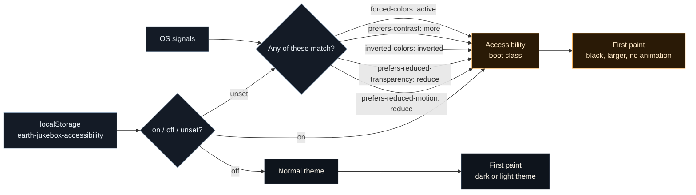

**Target: WCAG 2.2 AA.** This is a design target, **not a certification** — the site has not had a formal third-party audit. The `/accessibility` page says so in plain words and explains how to report a barrier.

---

## 🧑‍💻 One file, no dependencies

`engine.js` is the whole sound machine: data adapter, planner, synthesiser, stereo field, reverb, compressor, WAV encoder — and, if you want it, its own UI. Drop it into any page and it mounts itself.

```html
<!-- listen.html -->
<!doctype html>
<meta charset="utf-8" />
<title>Night Lights</title>
<script src="./engine.js" defer></script>
```

That is a working app. It tries `./data.json`, and falls back to a built-in 8-note demo when the file is missing (for example on `file://`).

### Console / module API

```js
SonificationEngine.load(json);                   // swap the dataset at runtime
SonificationEngine.play();                       // play the piece
SonificationEngine.next();                       // step forward one region
SonificationEngine.legend();                     // the four reference sounds
SonificationEngine.CONFIG.piece.spacing = 0.4;   // tune live, then play again
const buffer = await SonificationEngine.render('legend');   // offline AudioBuffer
SonificationEngine.toWav(buffer);                // → ArrayBuffer, 16-bit PCM stereo
```

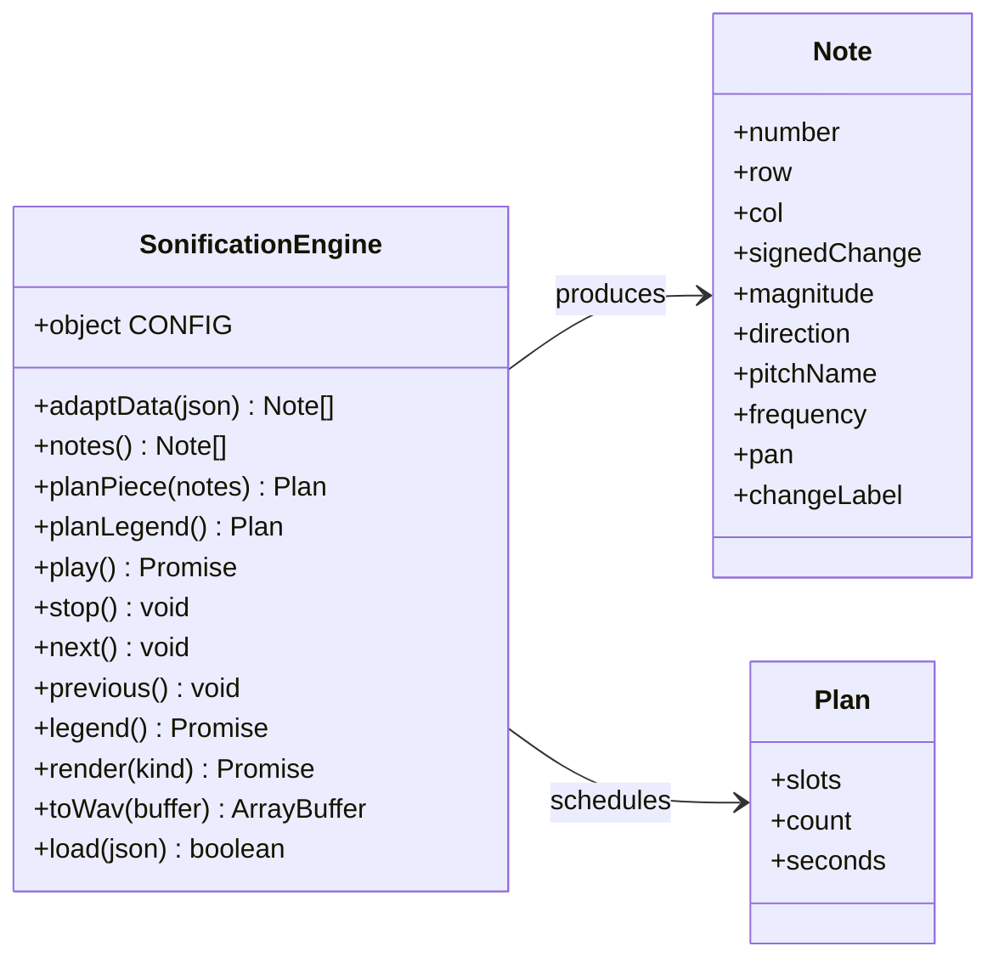

The React build wraps the same code with `createEngine({ headless: true, volume: 0.3 })` and adds **events**, **volume**, **`loadJSON()`** and **`getState()`** — the audio code is unchanged, and React never schedules a note itself.

| Event | Payload | Fires when |
|---|---|---|
| `loaded` | `{ notes, info, label, problem }` | A dataset finished loading (or failed) |
| `playState` | `boolean` | Playback starts or stops |
| `regionStart` | `(index, note)` | A region becomes current — during a piece or alone |
| `pieceEnd` | `{ kind: 'piece' \| 'region' \| 'legend', … }` | The scheduled sound finished |
| `stopped` | — | Stop finished fading the bus |
| `error` | `Error` with `kind: 'load' \| 'data' \| 'audio' \| 'empty'` | Anything the UI should surface |

```js
const engine = createEngine({ headless: true, volume: 0.3 });
engine.subscribe('regionStart', (index, note) => console.log(index, note.pitchName, note.pan));
await engine.loadJSON('./my-data.json', 'my-data.json');
```

---

## 🗃️ Bring your own data

One JSON object. Only `regions` and a finite `signed_change` are strictly required.

```json
{
  "dataset": "nightlights_2012_2023",
  "source": "NASA EIC visualization",
  "grid": { "rows": 16, "cols": 16, "total_cells": 256 },
  "regions": [
    {
      "id": 91,
      "row": 5,
      "col": 11,
      "score": 5.173828,
      "signed_change": 4.751953,
      "direction": "increase",
      "normalized_magnitude": 1.0,
      "rank": 1
    }
  ]
}
```

| Field | Type | Used for | Notes |
|---|---|---|---|
| `regions` | array | **required** | Missing → the file is rejected with a data error |
| `signed_change` | finite number | **required** | Absolute value → pitch; sign → direction when `direction` is missing |
| `direction` | string | routing | `increase`, `decrease`, `stable` (case-insensitive). `stable` is skipped; an unknown or missing label uses the sign; zero with no label is skipped |
| `row`, `col` | number | position | `col` drives the stereo field, `row` is visual only. Converted with `Number(...) \|\| 0`, so junk becomes `0` |
| `score` | number | provenance | Kept for the record; the player never reads it |
| `grid.rows`, `grid.cols` | positive integers | grid size | If absent, inferred from the highest row/column + 1 |
| `dataset`, `source` | string | attribution | Shown in the source line |
| `id`, `normalized_magnitude`, `rank` | any | provenance / tooling | Not required by the engine |

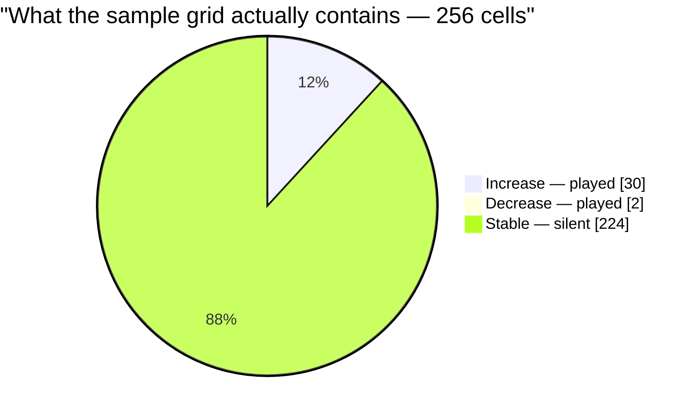

Load one three ways: **Load JSON** in the UI, a URL, or a `File` / `Blob` from code.

```js
await engine.loadJSON('./my-data.json', 'my-data.json');   // URL
await engine.loadJSON(fileInput.files[0], 'picked.json');  // File / Blob
await engine.loadJSON(parsedObject, 'pasted.json');        // already parsed
```

Validation is strict and visible: a failed load keeps the current data, shows a dismissible alert, and emits `error` with `kind: "load"` or `"data"`. Common causes are spelled out on screen — trailing comma, comment, single quote.

---

## 🧱 Architecture

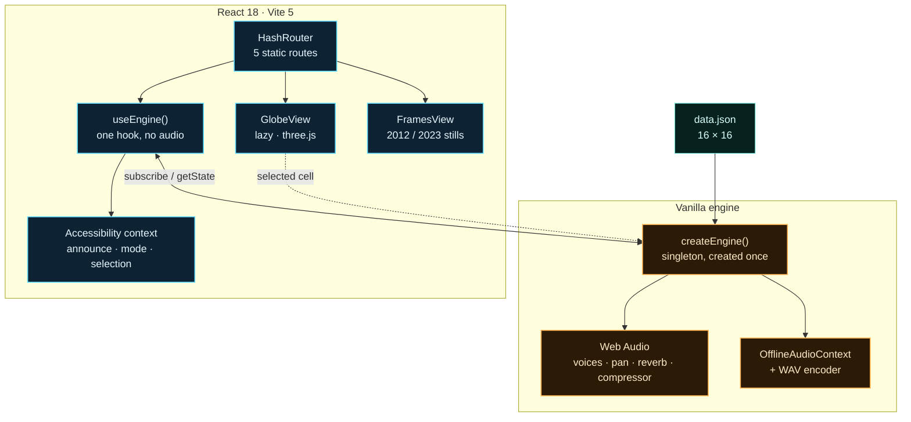

| Layer | Choice | Why |
|---|---|---|
| Build | **Vite 5 + React 18**, plain JS modules, no CSS framework | Fast static build, no runtime weight |
| Audio | **Hand-written Web Audio engine**, created once outside React | React re-renders cannot interrupt scheduled sound |
| 3D | **three.js**, lazy-loaded, disposed on unmount | Optional layer; the page works perfectly without it |
| Routing | **HashRouter** | Five routes on static hosts, zero server config |
| Fonts | **System fonts only** | No CDN, no external request, no layout shift |
| Storage | **`localStorage`**, one key, inside `try/catch` | Remembers one accessibility preference, nothing else |
| Encoding | **`OfflineAudioContext` + hand-written WAV header** | Deterministic export, 44.1 kHz / 16-bit / stereo |

### The audio graph, exactly

```text
oscillator → gain (attack · decay · sustain) → StereoPanner → bus input
                                                               ├─→ Convolver (1.6 s, fixed seed) → wet 0.18 ─┐
                                                               └──────────────────────────────────────────────→ DynamicsCompressor (threshold −18 dB, 4:1) → master 0.4 → destination
```

Details that matter:

- **Fixed-seed impulse response** — the room is generated from an LCG with a constant seed, so every run sounds identical.
- **A-weighting loudness compensation** — low notes are lifted (up to +12 dB, capped) so D3 does not vanish next to D6.
- **Exponential envelopes** — natural decay, plus a 40 ms master fade on stop that also kills the reverb tail.
- **Ticket counter** — every play/stop bumps a number; stale timers check it and stay quiet.
- **Graceful degradation** — no Web Audio, a blocked context, or a missing `OfflineAudioContext` produce a plain-language message, not a broken button.

---

## 🛠️ Configuration

Every knob lives in one `CONFIG` object. Change it, press play, hear it — no rebuild.

| Key | Default | Meaning |
|---|---|---|
| `rootMidi` | `62` | D4 — the root of the scale |
| `scale` | `[0,3,5,7,10,12,15,17,19,22,24]` | D minor pentatonic, two octaves |
| `decreaseShift` | `-12` | Decreases drop a full octave |
| `panWidth` | `0.9` | Share of the stereo field used |
| `piece.spacing` | `0.8` | Seconds between notes |
| `piece.maxSeconds` | `30` | Hard cap on a piece |
| `piece.leadIn` | `0.12` | Silence before the first note |
| `increase` | `triangle · 10 ms · 0.8 s` | Bright voice |
| `decrease` | `sine · 120 ms · 1.2 s` | Dark voice |
| `reverb` | `wet 0.18 · 1.6 s · decay 3` | Room |
| `compressor` | `−18 dB · ratio 4` | Catches overlaps |
| `masterGain` | `0.4` | Output level |
| `loudness` | `1` | Low-note compensation, `0` disables |
| `changeLabels` | `≤0.34 small · ≤0.67 medium · ≤1 large` | Spoken size words |
| `mapCellLimit` | `4096` | Above this, the 2D map is not drawn |
| `dataUrl` / `demoFallback` | `data.json` / `true` | What to fetch, and what to do when it is missing |

---

## 🚀 Run it locally

**[▶ Or just open the live demo](https://aham-bhramasmi.vercel.app/)** — no install, nothing to build.

```bash
git clone https://github.com/Diksha-MukherjeeAgarwal/Aham-Bhramasmi.git
cd Aham-Bhramasmi
python -m http.server 8000          # or: npx serve .   |   php -S localhost:8000
```

### 1 · The landing shell

**<http://localhost:8000/>** — header, the full 8K night-lights still, footer. This is the marketing shell; it is intentionally light.

### 2 · The engine, on one line of HTML

Create `listen.html` next to `engine.js` with the three lines from the section above, then open **<http://localhost:8000/listen.html>**. The engine mounts its own complete UI: transport, region list, 2D grid map, legend, self-check table, WAV export, keyboard shortcuts.

> Opening the file directly (`file://`) still works — the fetch fails, the built-in demo loads, and everything else behaves the same.

### 3 · The full five-route site

The production bundle is in `frontend/dist`. Serve **that folder** as the web root:

```bash
cd frontend/dist
python -m http.server 4173
```

Then open **<http://localhost:4173/#/>**.

### 4 · Build from source

```bash
cd frontend
npm install
npm run build      # emits frontend/dist
```

Keep `base: "./"` in `vite.config.js` so the build also works under a project subpath such as `/Aham-Bhramasmi/`. The React/Vite source is included in this repository; `npm run build` generates `frontend/dist`.

### Deploy

| Target | How |
|---|---|
| **Vercel** (current live demo) | Link the `frontend/` project and serve `frontend/dist`; local Vercel metadata is intentionally not tracked |
| **GitHub Pages** | Publish `frontend/dist` on the Pages branch or via a Pages workflow |

After the first build the site is fully local: no CDN, no external fonts, and no network calls beyond the files in `public/`.

---

## 🗂️ Repository map

```text
Aham-Bhramasmi/
├── .gitignore
├── engine.js                      # dependency-free sonification engine
├── assets/
│   └── Datasets/                  # NASA night-lights stills, 2012 + 2023 (8K, 16:9)
├── data/
│   └── processed/
│       └── earth_jukebox_results  # CV output: 16 × 16 grid → 32 playable regions
├── frontend/
│   ├── README.md                  # install, build, and deployment instructions
│   ├── index.html
│   ├── package.json
│   ├── package-lock.json
│   ├── vite.config.js
│   ├── public/                    # runtime data and image assets
│   └── src/                       # five-route accessible sonification app
└── readme.md                      # project overview, mapping, data, and run instructions
```

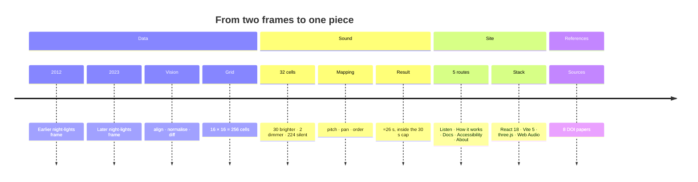


## 🧪 Accessibility checks

The keyboard and screen-reader checklist below is a manual QA guide. Automated browser-recording harnesses are kept out of the submission; accessibility claims should be confirmed with real assistive technology and user testing.

Real user testing with blind and low-vision listeners remains the first item on our roadmap.

Manual pass before every push:

- [ ] Tab from a cold load — does the skip link appear first?
- [ ] Space with a button focused presses the button, not the piece
- [ ] Every region button reads a complete sentence
- [ ] <kbd>S</kbd> kills audio **and** speech, reverb tail included
- [ ] <kbd>A</kbd> survives a reload, and applies before first paint
- [ ] 320 px wide — no horizontal scrolling
- [ ] WebGL disabled — image frames take over, region list intact
- [ ] Screen reader on — no wall of speech over the music

---

## 🎯 What this is **not**

Honesty is part of the design. These lines are printed on the site, not hidden in a README.

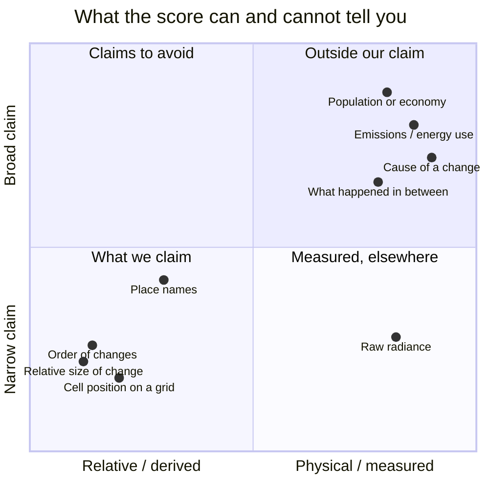

- **Not a measure of emissions, electricity use, population or economic activity.** Night-lights change has many causes: growth, outages, war, migration, gas flaring.
- **Not a time series.** The visualization compares two frames, so the music cannot show what happened between them.
- **Not geography by name.** Row and column are the only location the player has; the visualization is the geographic reference.
- **Not a scientific instrument.** Two regions with the same relative score get the same note even when their physical changes differ wildly.
- **Not a global ranking.** The default file is a sample of the grid, meant to make the idea audible and inspectable.
- **Not a summary of large files.** The 30-second cap truncates; the interface tells you exactly how many regions were left out.
- **Not yet validated with users.** The prototype has **not** been tested in a controlled study with blind and low-vision participants. That is our top priority, and the reason the feedback form exists.

---

## 🎯 Our mission

We believe scientific discoveries should be accessible to everyone, regardless of how they interact with information.

Earth Jukebox aims to make satellite data more inclusive by turning complex visual information into an experience that can be **heard, explored and understood** — and by publishing the mapping, the limits and the code, so anyone can check the claim.

---

## 🛣️ Roadmap

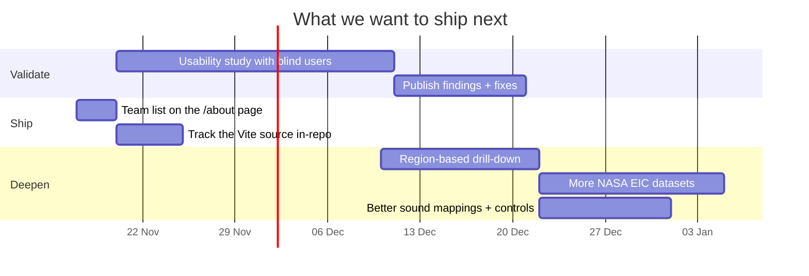

- [ ] Conduct usability testing with blind and low-vision users
- [ ] Introduce region-based exploration (world → region → detail)
- [ ] Support additional NASA EIC datasets, including lightning
- [ ] Improve sound mappings and accessibility controls
- [ ] Expand the range of datasets available for sonification
- [x] Deterministic engine with a fixed, documented mapping
- [x] Five-route site with 3D globe, image frames and a region list
- [x] Keyboard-first interaction and a spoken explanation
- [x] Accessibility mode applied before first paint
- [x] WAV export and bring-your-own-JSON
- [ ] Team names on the `/about` page — the section is a live placeholder; this README is the source of truth until it ships

---

## 🧑‍🔬 Development story

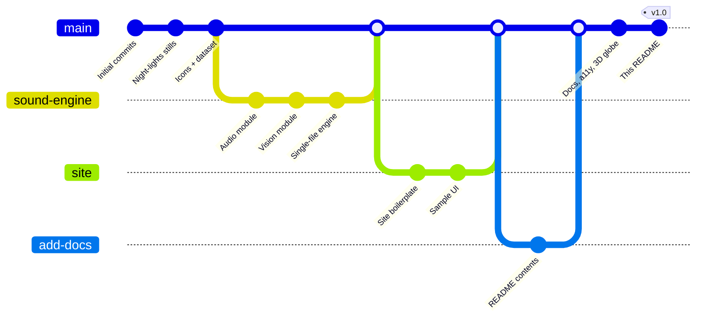

Three tracks, one contract: the **engine** was written first and stays dependency-free, the **site** wraps it without ever touching its audio code, and this **README** is the contract for both.

---

## 👥 Team

<div align="center">

**Aham-Bhramasmi**

├── engine.js                      # dependency-free sonification engine
|:--:|---|
| 1 | **Diksha Mukherjee Agarwal** |
| 2 | **MD Mamun** |
| 3 | **Sofiur Rahaman** |
| 4 | **Anumitra Saha** |
| 5 | **Drishan Roy** |

<sub>Built with curiosity, creativity, and the belief that data should be experienced by everyone.</sub>

<sub>**Project:** Earth Jukebox: Change Mode · **Tagline:** Hear how the Earth changes, one note at a time.</sub>

<sub>Built in 2026 for the NASA Space Apps Challenge, *The Earth Information Jukebox*. An independent submission — not an official NASA product.</sub>

</div>

---

## 📚 References

The project cites only the eight DOI references supplied with the challenge brief. Every number in the mapping traces back to code in this repository; every claim about sonification traces back to these.

<details>
<summary><b>Eight papers</b> — sonification, accessibility and data representation</summary>

<br>

1. Arcand, K. K., Schonhut-Stasik, J., Kane, S. G., Sturdevant, G., Russo, M., Watzke, M., Hsu, B., & Smith, L. F. (2024). *A Universe of Sound: processing NASA data into sonifications to explore participant response.* Frontiers in Communication, 9. [doi:10.3389/fcomm.2024.1288896](https://doi.org/10.3389/fcomm.2024.1288896)
2. Metatla, O., Bryan-Kinns, N., Stockman, T., & Martin, F. (2016). *Sonification of reference markers for auditory graphs: effects on non-visual point estimation tasks.* PeerJ Computer Science, 2, e51. [doi:10.7717/peerj-cs.51](https://doi.org/10.7717/peerj-cs.51)
3. Putra, Z. P., & Setiawan, D. (2024). *Representation of negative numbers: point estimation tasks using multi-reference sonification mappings.* PeerJ Computer Science, 10, e2275. [doi:10.7717/peerj-cs.2275](https://doi.org/10.7717/peerj-cs.2275)
4. Sharif, A., Aitharaju, N., Krishnaswamy, S., & Wobbrock, J. O. (2025). *Data Sonification for Screen-Reader Users: When and When Not to Use.* W4A, 160–171. [doi:10.1145/3744257.3744263](https://doi.org/10.1145/3744257.3744263)
5. Enge, K., Elmquist, E., Caiola, V., Rönnberg, N., Rind, A., Iber, M., Lenzi, S., Lan, F., Höldrich, R., & Aigner, W. (2024). *Open Your Ears and Take a Look: A State-of-the-Art Report on the Integration of Sonification and Visualization.* Computer Graphics Forum, 43. [doi:10.1111/cgf.15114](https://doi.org/10.1111/cgf.15114)
6. Holloway, L. M., Goncu, C., Ilsar, A., Butler, M., & Marriott, K. (2022). *Infosonics: Accessible Infographics for People who are Blind using Sonification and Voice.* CHI, 1–13. [doi:10.1145/3491102.3517465](https://doi.org/10.1145/3491102.3517465)
7. Hoque, M. N., Ehtesham-Ul-Haque, M., Elmqvist, N., & Billah, S. M. (2023). *Accessible Data Representation with Natural Sound.* CHI, 1–19. [doi:10.1145/3544548.3581087](https://doi.org/10.1145/3544548.3581087)
8. Seo, J., Xia, Y., Lee, B., McCurry, S., & Yam, Y. (2024). *MAIDR: Making Statistical Visualizations Accessible with Multimodal Data Representation.* CHI, 1–22. [doi:10.1145/3613904.3642730](https://doi.org/10.1145/3613904.3642730)

</details>

Data: NASA Earth Information Center / Scientific Visualization Studio — [*Change in Night Lights between 2012 and 2023*](https://svs.gsfc.nasa.gov/5276/). Derived scores are relative values, not raw radiance.

---

## 🤝 Feedback & contributions

We welcome feedback, suggestions and contributions. If you hit an accessibility barrier, have an idea, or want to build with the engine — open an issue or send a pull request.

We are especially interested in feedback from **blind and low-vision users**, accessibility researchers, and developers working on data sonification.

**[→ Open the feedback form](https://forms.gle/GLLUH9Xqfxu6byCq6)** · [Issues](https://github.com/Diksha-MukherjeeAgarwal/Aham-Bhramasmi/issues)

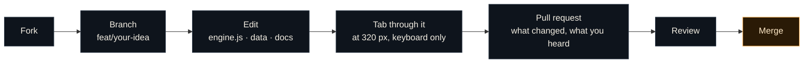

**Good first issues:** add the team list to `/about`, track the Vite source tree, and take the accessibility checklist above for a spin with your own screen reader.

What we care about in review:

1. **One mapping.** Don't add a second way to encode the same variable. If it changes what a sound *means*, it belongs on `/how-it-works` first.
2. **Text parity.** Anything added to the visual layer needs a text equivalent — a sentence, a table row, or a live-region message.
3. **No new runtime dependencies** in `engine.js`. It stays a single file with zero imports.
4. **Determinism.** Same file in, same piece out. If you touch randomness, seed it.
5. **Colour is never the only cue.** Amber/cyan come with ▲/▼ and words, always.

---

## 📄 License

**MIT** © 2026 the Aham-Bhramasmi team.

React and React DOM are MIT; three.js is MIT. The NASA night-lights imagery remains the property of NASA and is used here for attribution and demonstration.

---

<div align="center">

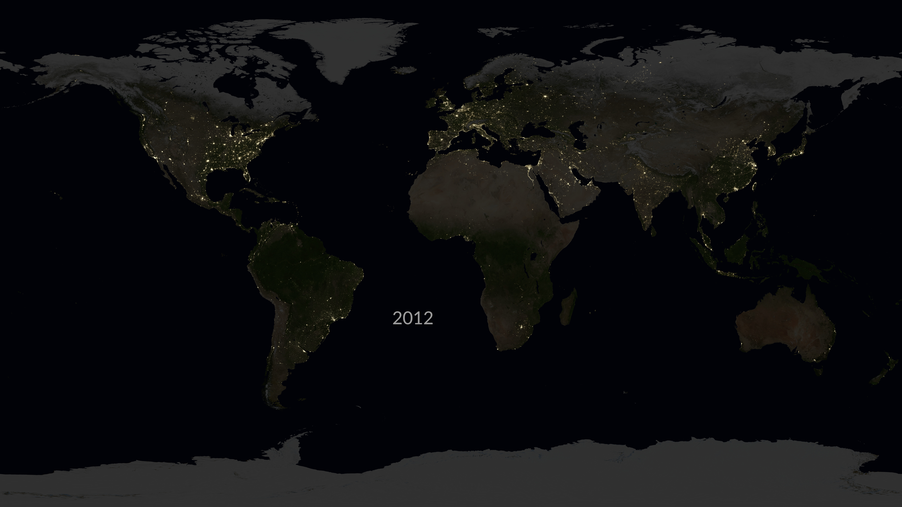

### *Listen to the lights come on.*

**[▶ Live demo](https://aham-bhramasmi.vercel.app/)** · **[🎼 Read the mapping](#-the-mapping-data--sound)** · **[⌨️ Learn the keys](#%EF%B8%8F-keyboard-first)** · **[💬 Send feedback](https://forms.gle/GLLUH9Xqfxu6byCq6)**

<sub>Hear how the Earth changes, one note at a time.</sub>

<sub>🌍 · 🎧 · ♿</sub>

</div>
